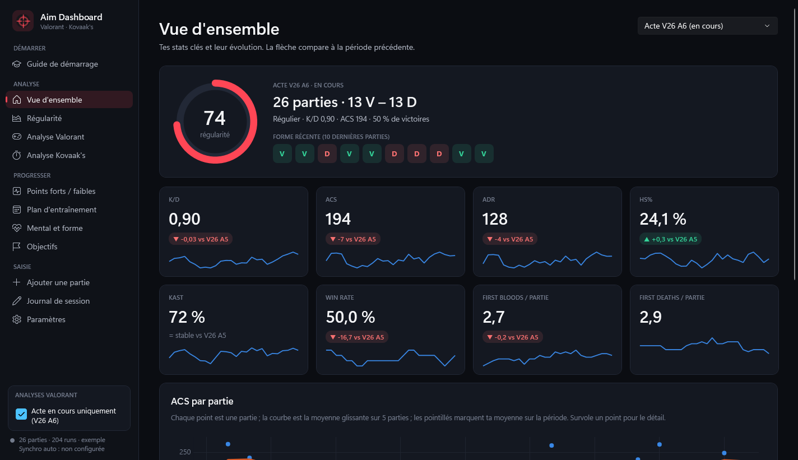
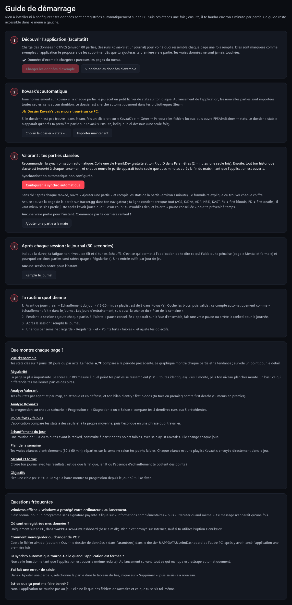
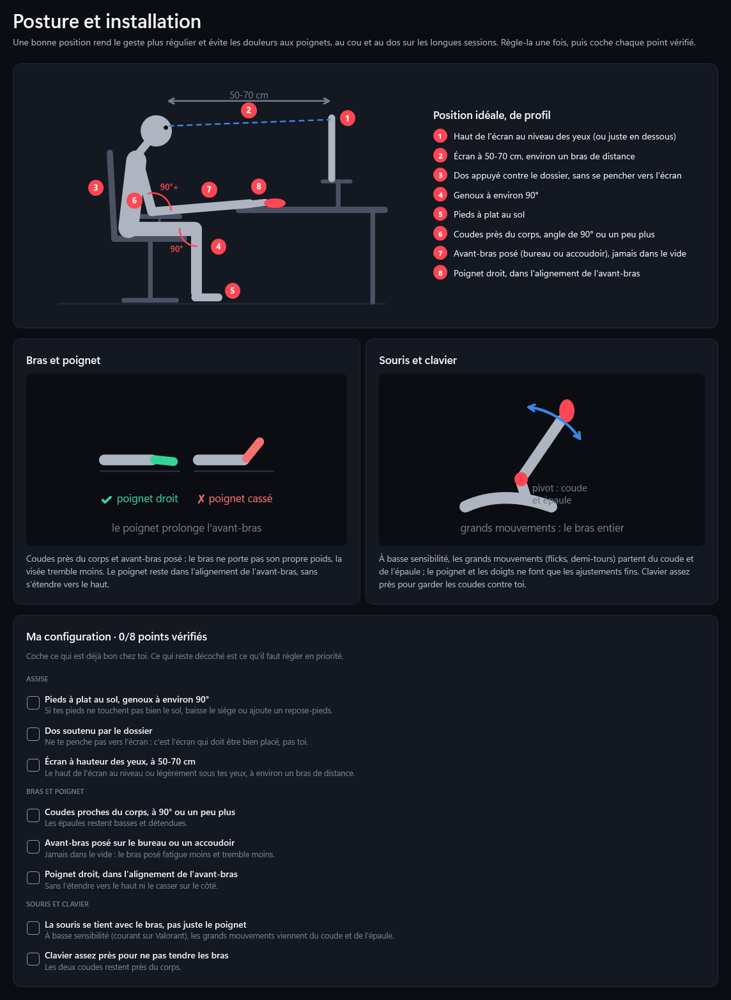
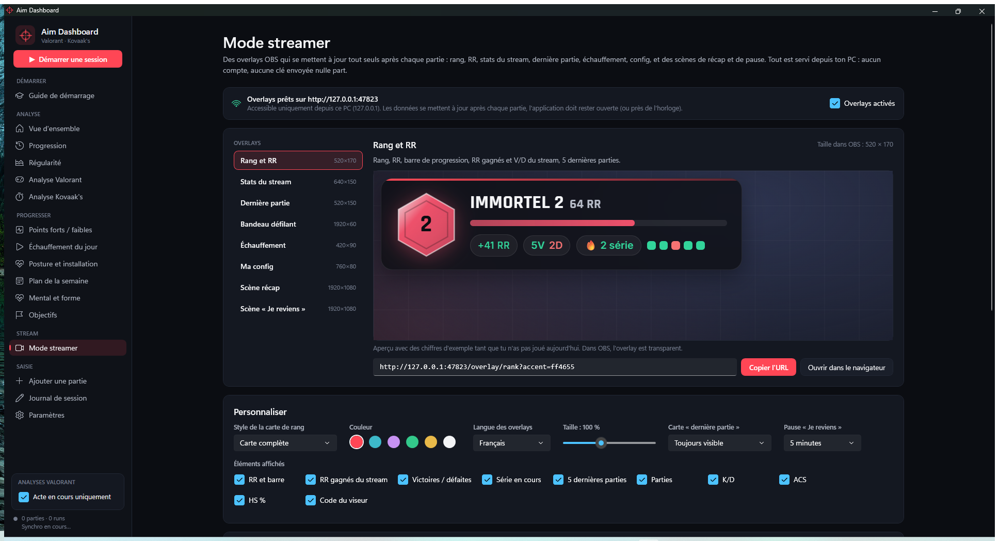

# Aim Dashboard — Valorant & Kovaak's

Application Windows (un seul `AimDashboard.exe`) pour suivre ses progrès en aim, avec la **régularité** comme métrique centrale : points forts et faibles, échauffement et plan d'entraînement adaptés à tes résultats (playlists Kovaak's envoyées directement dans le jeu), suivi des sessions et impact de la forme et du mental.

Ce dépôt ne contient que les versions publiées de l'application.

## ⬇️ Télécharger et lancer

**[➡️ Télécharger la dernière version (AimDashboard.exe)](https://github.com/FraZy34/aim-dashboard/releases/latest/download/AimDashboard.exe)**

1. **Télécharge** `AimDashboard.exe`, range-le où tu veux (Bureau, dossier Jeux…) et **double-clique dessus**. Rien à installer : tout est inclus dans le fichier.
2. **Si Windows affiche « Windows a protégé votre ordinateur »** : *Informations complémentaires* → *Exécuter quand même* (programme sans signature payante, une seule fois).
3. Laisse-toi guider par le **Guide de démarrage**.

**Gratuit :** aucun compte, aucune licence, aucun abonnement. Tu peux le partager librement (sans le vendre ni le modifier).

**Mises à jour :** automatiques. Quand une nouvelle version sort, une fenêtre te propose « Mettre à jour maintenant » ; l'application se met à jour et redémarre toute seule. Tes données sont conservées.

> Configuration requise : Windows 10 ou 11, 64 bits.

## Fonctionnalités

| Page | Contenu |
|---|---|
| **Vue d'ensemble** | K/D, ACS, ADR, HS%, KAST, win rate, FB/partie et régularité, avec la tendance par rapport à la période précédente (7 j, 30 j, ou par acte). Graphique de l'ACS par partie et tableau par acte. Alerte « pause conseillée ». |
| **Progression** | Rapport de chaque semaine (ranked, RR, Kovaak's, sessions, objectifs, pistes pour la semaine suivante), exportable en HTML imprimable en PDF ; courbe de rang et de RR ; records personnels (notification à chaque record battu) ; meilleures conditions de jeu (créneau, jour, nombre de parties avant de décrocher) ; progression Kovaak's par famille sur le long terme. Impact de l'entraînement **sur la durée** : semaines avec ou sans tracking, clicking… comparées à ton HS% et ton ACS en ranked. |
| **Régularité** | Écart-type et coefficient de variation de l'ACS, du K/D et du HS% ; score de régularité sur 100 ; moyenne glissante avec bande min/max ; évolution du score ; 5 meilleures et 5 pires parties, et **ce qui les différencie** (HS%, entry, KAST, fatigue, tilt, échauffement, rang de la partie dans la journée, map, agent). |
| **Analyse Valorant** | Ta place dans chaque partie face aux autres joueurs (classement, top frag, ACS et HS% vs le lobby), solo ou en groupe, kills par arme (Vandal / Operator…), économie (pistolet, eco, force, full), trades, clutchs (1vX), moment de tes morts, stats par agent et par map, attaque/défense, entry et corrélation first death / issue du round. **Premiers duels** par map et par côté (avec la phrase qui résume ton plus gros point faible), morts tradées, et **aim en deathmatch / TDM** (HS% et K/D importés via HenrikDev, comparés à ta ranked). |
| **Analyse Kovaak's** | Progression par scénario (score, précision, kills/s, TTK moyen), filtre par type (clicking, tracking, flicking, switching), meilleur score et moyenne des 7 derniers jours, régularité et tendance par scénario. **Contrôle de la sensibilité** : ta sens Kovaak's est comparée à ta sens Valorant (conversion cm/360 et autres échelles), avec les dates de changement de sens. |
| **Points forts / faibles** | Moteur de règles lisible ; chaque point faible est expliqué en une phrase et relié à un axe de travail. |
| **Échauffement du jour** | Routine de 15 à 20 min avant la ranked (range, tracking, clicking, counter-strafe, duels) adaptée aux points faibles, avec sa **playlist Kovaak's** envoyée dans le jeu ; une case par bloc ; la séance validée compte comme « échauffement fait » dans le journal. Les blocs Kovaak's **se cochent tout seuls** quand tu joues leurs scénarios (avec ton score face à l'objectif), l'ordre va **du plus facile au plus dur**, et un **indice de forme du jour** compare tes scores à ton niveau habituel (« Tu es à 94 % ») avec un conseil avant la ranked ; l'application vérifie au fil des jours si cet indice prédit tes résultats. |
| **Plan de la semaine** | 3 à 7 vraies séances (30 à 90 min) réparties sur la semaine selon tes points faibles. Chaque séance = une **playlist Kovaak's écrite directement dans le jeu** + un bloc Valorant + un objectif chiffré. **Beaucoup de variété** : 4 à 6 scénarios par séance, 3 parties pour tes points faibles et 1 à 2 pour les autres ; à partir de 50 min, la séance passe en **2 parties** (Kovaak's → Valorant → Kovaak's sur une famille complémentaire → Deathmatch pour mettre en pratique), plus de 110 scénarios populaires, un scénario revient le moins possible dans la semaine, et chaque séance a son **format** (Échelle, Contraste, Immersion, Spécial Valorant, Micro-précision, Découverte, Défi régularité). Tes scénarios à retravailler ouvrent la séance avec 3 parties. Séance « bilan » en fin de semaine sur les scénarios joués. **Semaine légère** proposée après 3 semaines chargées (désactivable), et **test de niveau** toutes les 2 semaines sur les benchmarks Voltaic, suivi test après test. |
| **Adaptation automatique** | Chaque scénario reçoit un mode selon tes résultats : **Précision** (trop de tirs ratés : ralentis), **Pousser** (précision bonne mais score bloqué : accélère), **Consolider** ou **Découverte**, avec un objectif chiffré **atteignable**, calculé sur tes propres résultats (entre ta moyenne récente et ton record, précision +3 points max) et le niveau de difficulté adapté. **Boucle de retour** : l'application mesure si tes séances Kovaak's améliorent vraiment tes parties du même jour, et donne plus de place à ce qui marche. Le plan se **réajuste chaque jour** (séances manquées reportées), cible ta **pire map**, et l'échauffement s'adapte à ta **forme du jour** (version courte si fatigué ou alerte pause). Seuils de HS% adaptés à ton **rang** (lu automatiquement via HenrikDev). Suivi des **benchmarks Voltaic**. |
| **Sessions suivies** | Bouton **Démarrer une session** (forme, humeur et durée prévue) : un **échauffement adapté est généré à chaque démarrage** (points faibles, dernier bilan, alerte pause, forme, humeur, durée), envoyé dans Kovaak's et ouvert directement. Puis, puis **Terminer** (forme et humeur à la fin) : l'application prend toutes les parties classées jouées entre les deux et rédige un **bilan** : résultats vs ta moyenne, évolution pendant la session, forme et tilt, l'échauffement Kovaak's fait juste avant était-il adapté, et ce que le prochain échauffement va changer (l'axe à corriger passe en priorité). Une partie arrivée après la fin met le bilan à jour automatiquement. |
| **Sessions automatiques** | La session **démarre toute seule** quand Valorant ou Kovaak's s'ouvre et **se termine** 15 min après que tu as arrêté de jouer, avec son bilan dans le journal. Si tu as joué application fermée, une session **rattrapée** est créée autour de ces parties. Une notification permet de noter ta forme ; désactivable dans Paramètres. |
| **Échauffement physique** | 3 à 5 min avant Kovaak's, en tête de l'échauffement du jour : 9 exercices illustrés (poignets, poings, avant-bras, doigts, épaules, cou, bras croisé, grand étirement, squats), cochés un par un. Pause d'une minute entre les games (rappelée dans la notification de nouvelle partie) et rappel **20-20-20** pour les yeux pendant une session. |
| **Posture et installation** | Schéma de profil de la position idéale avec repères numérotés (écran à hauteur des yeux à 50-70 cm, dos, genoux et coudes à 90°, avant-bras posé, poignet droit), détails bras/poignet et souris (à basse sensibilité, le mouvement part du coude), liste de vérification de ta configuration. |
| **Mental et forme** | ACS selon la fatigue, le tilt et l'échauffement, corrélations et conclusions en phrases. |
| **Objectifs** | Objectifs chiffrés (HS%, K/D, ACS, ADR, KAST, win rate, régularité, score Kovaak's) avec barre de progression. **Prévision** : « à ce rythme, tu atteins 25 % de HS dans environ 5 semaines ». |
| **Mode streamer** | **8 overlays OBS** (source « Navigateur », fond transparent) servis depuis ton PC, sans compte ni clé envoyée à un tiers, et mis à jour tout seuls après chaque partie : rang et RR (carte, pilule ou barre), stats du stream comparées à ta moyenne, carte « dernière partie » animée, bandeau défilant, badge « Échauffé », ta config (sens, DPI, eDPI, viseur), scène **récap** de fin de stream et scène **« Je reviens »** avec compte à rebours. Aperçu en direct, couleur, langue (FR/EN), taille et éléments réglables. **Récap du stream** prêt à coller sur Discord ou X, comparaison **en stream / hors stream**. |
| **Bot de chat Twitch** | Le chat tape **!rank, !rr, !stats, !lastgame, !sens, !crosshair, !warmup** (et leurs alias) et ton compte répond tout seul avec tes vraies stats, en fil sous le message. Option : annonce de chaque nouvelle partie dans le chat. Connexion par code sur twitch.tv/activate (l'application ne voit jamais ton mot de passe, droits limités au chat), délai réglable entre deux réponses, commandes activables une par une avec l'aperçu de ce que le bot répondrait maintenant. |
| **Délai de stream** | Pilote **[Stream Delay](https://github.com/FraZy34/stream-delay-app)** (délai réglable en direct pour OBS → Twitch, utile contre le stream sniping) depuis *Mode streamer* : état en direct (EN DIRECT, TAMPON EN COURS, EN DIFFÉRÉ), **Armer**, **Activer le différé**, **Couper**, ajustement du délai, avertissements d'OBS. Stream Delay reste une application à part : Aim Dashboard le lance et lui parle sur son API locale (127.0.0.1, jeton lu sur ce PC). |
| **Langue / Language** | Interface en **français ou en anglais** (Paramètres → Application ; par défaut, la langue de Windows). Le bot Twitch répond dans la langue choisie ; les overlays ont leur propre réglage FR/EN. |
| **Saisie** | Formulaire rapide pour une partie, import CSV/JSON avec modèles fournis, journal de session, paramètres. |

## Tes données

Tout reste sur ton PC (`%APPDATA%\AimDashboard`) : base de données, réglages et clé API. Les seules connexions sont l'API HenrikDev (si tu l'actives, avec ta propre clé gratuite) et GitHub pour les mises à jour. L'application ne fait aucun scraping de sites qui l'interdisent (pas de tracker.gg).

Aim Dashboard n'est ni développé ni soutenu par Riot Games ou Kovaak's.

---
© 2026 FraZy34 — logiciel gratuit. Voir [LICENSE](LICENSE).
